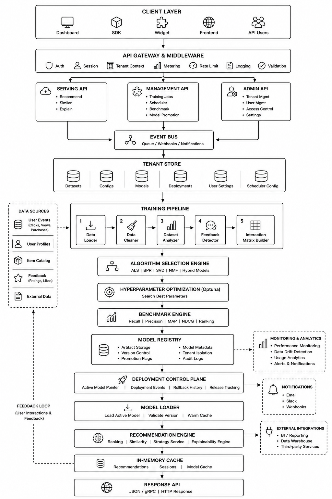

# Proactive AI

Proactive AI is a multi-tenant recommendation platform with a FastAPI backend, a React admin frontend, tenant-scoped training pipelines, model registry and promotion flows, and production recommendation serving.

The current repository layout is split into two top-level apps:

- `backend/` contains the API, training pipeline, tenant isolation, model registry, deployment control plane, SmartDB ingestion, and tests.
- `frontend/` contains the Vite/React dashboard that the backend can serve at `/app` after a frontend build.

## What the platform does

- Trains recommendation models from uploaded files or SQL sources.
- Benchmarks and tunes multiple algorithms per tenant.
- Saves trained models into a tenant-scoped registry.
- Promotes one model to the canonical active deployment.
- Generates dense item embeddings during training using a sentence-transformer model and stores them in a tenant-scoped OpenSearch index for content-aware similarity and hybrid scoring.
- Serves recommendations, similar items, explanations, model listings, jobs, and deployment state through authenticated APIs.
- Supports SmartDB SQL/NoSQL ingestion helpers and tenant webhooks.

## Repository layout

```text
.
|-- backend/
|   |-- admin/                     # Admin auth, tenant management, webhook config
|   |-- api/                       # FastAPI routes, auth, middleware, metering
|   |-- config/                    # Settings and database config helpers
|   |-- core/                      # Training, recommendation, deployment, tenants
|   |   |-- data_processing/
|   |   |   |-- embedding_enricher.py  # Sentence-transformer encoding + OpenSearch upsert
|   |   |   |-- data_cleaning.py
|   |   |   |-- interaction_matrix.py
|   |   |   |-- dataset_analyzer.py
|   |   |   `-- feedback_detector.py
|   |   |-- pipeline/
|   |   |   |-- training_pipeline.py   # 7-step pipeline 
|   |   |   `-- serving_pipeline.py    # Hybrid CF + embedding scoring at serve time
|   |   `-- ...
|   |-- sdk/                       # Webhook push helpers and JS widget assets
|   |-- smart_db_csv_builder/      # SmartDB build, schema, connectors, services
|   |-- static/                    # Swagger UI assets served by FastAPI
|   |-- tenants/                   # Tenant configs, data, models, deployment state
|   |-- tests/                     # Backend tests
|   |-- app_factory.py             # FastAPI assembly
|   |-- main.py                    # API and CLI entrypoint
|   |-- Dockerfile
|   `-- docker-compose.yml
|-- frontend/
|   |-- src/                       # React application
|   |-- dist/                      # Built frontend served by backend when present
|   `-- package.json
|-- apiend.md
|-- ProactiveAiApiGuide.md
`-- UserManual.md
```

### Architecture Diagram



## Backend architecture

- `backend/app_factory.py` assembles middleware, routes, admin routes, SmartDB routes, static assets, Swagger UI, and frontend serving.
- `backend/api/gateway/` handles auth, tenant state, request metering, and rate limiting.
- `backend/api/routes/` exposes training, recommendation, models, deployment, jobs, analytics, benchmark, batch, explain, scheduler, and similar-item endpoints.
- `backend/core/pipeline/` contains training and serving pipeline orchestration.
- `backend/core/data_processing/embedding_enricher.py` encodes item metadata into dense vectors using a sentence-transformer model and persists them into a per-tenant OpenSearch index. The `EmbeddingStore` handle returned after training exposes `most_similar()`, `score_candidates()`, and `blend_scores()` — the same interface is used at serving time without any in-memory matrix.
- `backend/core/recommendation/` contains strategy selection, ensemble logic, and runtime inference behavior.
- `backend/core/deployment/` contains the canonical deployment control plane, active deployment state, event history, and rollback behavior.
- `backend/core/tenants/` contains tenant config, cache, directories, and request context helpers.

## Main API surfaces

### Admin and tenant management

These routes are mounted under `/admin`.

- `POST /admin/auth/login`
- `GET /admin/auth/me`
- `GET /admin/health`
- `GET /admin/session/status`
- `GET /admin/algorithms`
- `POST /admin/tenants`
- `GET /admin/tenants`
- `GET /admin/tenants/{tenant_id}`
- `PATCH /admin/tenants/{tenant_id}`
- `DELETE /admin/tenants/{tenant_id}`
- `POST /admin/tenants/{tenant_id}/rotate-key`
- `PATCH /admin/admin/tenants/{tenant_id}/webhook`

### Training

- `POST /train/file`
- `POST /train/sql`
- `GET /jobs`
- `GET /jobs/{job_id}`
- `DELETE /jobs/{job_id}`

### Recommendation and serving

- `GET /recommend/options`
- `POST /recommend`
- `GET /similar/{item_id}`
- `GET /explain/{user_id}/{item_id}`
- `GET /models`
- `POST /models/{model_id}/promote`
- `GET /deployment/active`
- `GET /deployment/status`
- `GET /deployment/history`
- `POST /deployment/rollback`

### SmartDB

Mounted under `/smart-db-csv/api/...` and protected by `training:write` scope.

## Recommendation strategies

The recommendation service currently supports:

- `best_promoted_model`: use the active production deployment.
- `single_model`: use one explicitly selected model or algorithm.
- `ensemble_weighted`: blend multiple selected models using provided weights.

The response-building logic lives in `backend/core/recommendation/strategy_service.py`.

## Embedding enrichment

Item embedding generation runs as step 5 of 7 in the training pipeline, after the interaction matrix is built and before benchmarking begins. This ordering ensures embeddings are generated only for items that survive data cleaning and have real interactions.

The enricher encodes each item's metadata text (title, overview, genres, keywords, cast, director, or any configured column) using `all-MiniLM-L6-v2` and upserts the resulting vectors into OpenSearch. Each tenant gets an isolated index named `embeddings-{tenant_id}`.

At serving time the `ServingPipeline` attaches the `EmbeddingStore` returned from training. The `similar_items()` endpoint blends collaborative filtering scores with embedding cosine similarity. The `recommend()` endpoint accepts an optional `seed_item_id` to re-rank results using content similarity relative to a reference item.

The embedding step is non-fatal. If OpenSearch is unreachable or the sentence-transformer model fails to load, the pipeline logs a warning and continues to completion using collaborative filtering only.

### Embedding configuration

These settings can be passed in `TrainingConfig` or set via environment variables:

| Setting | Default | Description |
|---|---|---|
| `embedding_enabled` | `True` | Set to `False` to skip embedding enrichment entirely |
| `embedding_model` | `all-MiniLM-L6-v2` | Sentence-transformer model name |
| `embedding_text_col` | `None` (auto-detect) | Metadata column to embed; auto-detects if not set |
| `embedding_alpha` | `0.7` | CF weight in hybrid scoring; `1 - alpha` is embedding weight |

### OpenSearch environment variables

| Variable | Default | Description |
|---|---|---|
| `OPENSEARCH_HOST` | `localhost` | OpenSearch host |
| `OPENSEARCH_PORT` | `9200` | OpenSearch port |
| `OPENSEARCH_USER` | `admin` | OpenSearch username |
| `OPENSEARCH_PASSWORD` | `admin` | OpenSearch password |
| `OPENSEARCH_USE_SSL` | `false` | Set to `true` in production |

## Local development

### Backend

Run from the repository root:

```bash
python -m venv .venv
source .venv/bin/activate
pip install -r backend/requirements.txt
python -m uvicorn backend.main:app --reload
```

On Windows PowerShell, activate the environment with:

```powershell
.venv\Scripts\Activate.ps1
```

The API will be available at:

- `http://localhost:8000/docs`
- `http://localhost:8000/health`

### OpenSearch (local)

The embedding enricher requires a running OpenSearch instance. The quickest way to start one locally:

```bash
docker run -p 9200:9200 -p 9600:9600 \
  -e "discovery.type=single-node" \
  -e "plugins.security.disabled=true" \
  opensearchproject/opensearch:2.13.0
```

Or use the included `docker-compose.yml` under `backend/` which starts OpenSearch alongside the API.

### Frontend

```bash
cd frontend
npm install
npm run dev
```

If you want the backend to serve the dashboard at `/app`, build the frontend:

```bash
cd frontend
npm run build
```

Then start the backend and open:

- `http://localhost:8000/app`

## Docker

The active Docker files live under `backend/`.

Run from the `backend/` directory:

```bash
docker compose up --build
```

Optional worker profile:

```bash
docker compose --profile worker up --build
```

This compose stack builds from the repository root, uses `backend/Dockerfile`, and persists tenant data under Docker volumes mapped to `backend/tenants`, `backend/model_store`, and `backend/logs`.

## Authentication model

There are two auth flows:

- Admin auth uses bearer tokens from `POST /admin/auth/login`.
- Tenant runtime APIs use `X-API-Key`.

Default local admin credentials come from `backend/config/settings.py` unless overridden:

- username: `admin`
- password: `admin123`

## Tenant onboarding

### 1. Login as admin

```bash
curl -X POST http://localhost:8000/admin/auth/login \
  -H "Content-Type: application/json" \
  -d '{
    "username": "admin",
    "password": "admin123"
  }'
```

### 2. Create a tenant

Use the returned bearer token:

```bash
curl -X POST http://localhost:8000/admin/tenants \
  -H "Authorization: Bearer <ADMIN_TOKEN>" \
  -H "Content-Type: application/json" \
  -d '{
    "tenant_id": "demo-tenant",
    "display_name": "Demo Tenant",
    "tier": "starter",
    "scopes": ["training:write", "recommend:read", "jobs:read", "models:read", "models:write"]
  }'
```

The response returns the raw tenant `api_key` once. Store it immediately.

### 3. Call tenant APIs

```bash
curl -X GET http://localhost:8000/models \
  -H "X-API-Key: <TENANT_API_KEY>"
```

## Training flow

1. A tenant calls `POST /train/file` or `POST /train/sql`.
2. A background job is created and tracked under `/jobs/{job_id}`.
3. The training pipeline runs seven steps:
   1. Column detection — identifies `userID`, `itemID`, `rating`, and `timestamp` columns automatically.
   2. Feedback profiling — resolves whether the dataset is implicit, explicit, or hybrid.
   3. Data cleaning — deduplicates, filters, and splits into train/test sets.
   4. Interaction matrix — builds the sparse user-item matrix from the cleaned training split.
   5. Embedding enrichment — encodes item metadata using a sentence-transformer and upserts vectors into the tenant's OpenSearch index.
   6. Benchmark — evaluates all eligible algorithms against the test split.
   7. Hyperparameter tuning — runs Optuna on the shortlisted top algorithms.
4. If auto-promotion is enabled, the top-ranked model is promoted into the deployment control plane.
5. Recommendation endpoints use the promoted model by default, or explicit model selections depending on strategy. When an `EmbeddingStore` is attached, `similar_items` and `recommend` responses incorporate content-aware hybrid scoring.

## Configuration notes

The app is environment-driven. Important settings live in `backend/config/settings.py`, including:

- `API_HOST`
- `API_PORT`
- `AUTH_USERNAME`
- `AUTH_PASSWORD`
- `CORS_ORIGINS`
- `USE_V3_AUTH`
- `USE_V3_MULTITENANCY`
- `USE_V3_METERING`
- `USE_V3_ROUTES`
- `ALLOW_INACTIVE_MODEL_SERVING`

There is no committed `.env.example` in the current repository, so create your own `.env` only if you need overrides.

## Tech stack

- Backend: Python 3.11+, FastAPI, Pydantic v2, Uvicorn
- ML/data: NumPy, Pandas, SciPy, scikit-learn, Optuna
- Embeddings: sentence-transformers (`all-MiniLM-L6-v2`), PyTorch (CPU build)
- Vector store: OpenSearch 2.x with k-NN plugin (`opensearch-py`)
- SQL connectors: SQLAlchemy, psycopg2, PyMySQL
- Frontend: React 18, React Router, Vite, Framer Motion, Recharts
- Optional services: Redis, RQ, NoSQL connectors

## Notes for contributors

- Production backend routes and functions are now documented with docstrings across the main backend modules.
- API response shapes are usually assembled in `backend/core/*` service files, while `backend/api/routes/*` mostly handle validation and transport.
- Tenant data, model files, deployment state, and job state are stored under `backend/tenants/<tenant_id>/`.
- Embedding vectors are stored in OpenSearch, not on disk. Each tenant's index is named `embeddings-{tenant_id}`. To wipe a tenant's embeddings call `EmbeddingEnricher().delete_tenant_index(tenant_id)`.
